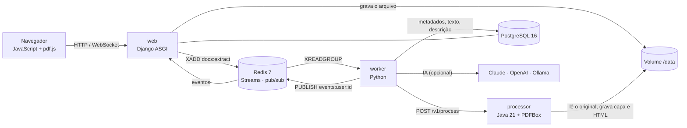
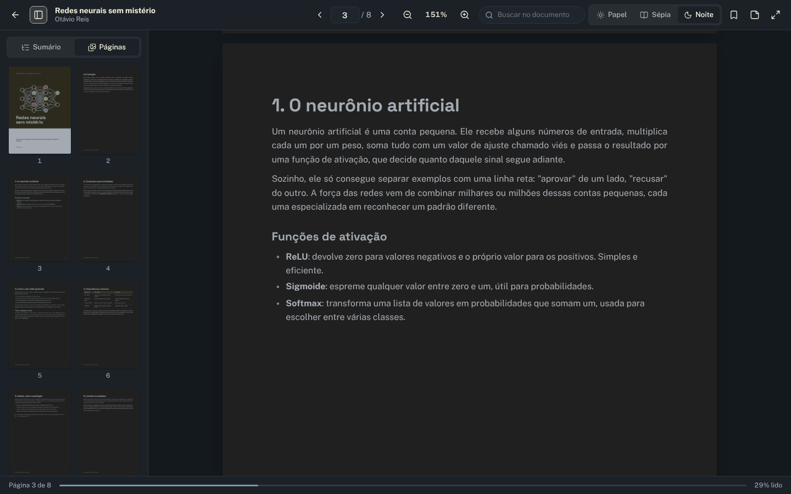

<p align="center">
  
</p>

<h1 align="center">Lume<br><sub><sup><sup><sub>Copyright (©) 2026 Clara A. Portes</sub></sup></sup></sub></h1>

<p align="center">
  Biblioteca web para organizar e ler PDFs e DOCX: você arrasta os arquivos, o Lume gera as capas, escreve uma descrição de cada documento com IA e abre tudo num leitor próprio que lembra onde você parou.<br>
  Pronto para usar, estudar ou adaptar.
</p>

<p align="center">
  Python 3.13 · Django 5.2 · Java 21 + PDFBox · JavaScript · PostgreSQL 16 · Redis 7 · WebSockets · Docker Compose · Pytest
</p>

---

> **Manual completo:** [`Manual-Lume.pdf`](Manual-Lume.pdf) explica a instalação, cada tela, o leitor, a descrição por IA, a arquitetura, a API, a configuração, os testes e a solução de problemas, passo a passo (cópia em [`docs/`](docs/Manual-Lume.pdf)).

> **Banco de dados:** [`Banco-de-Dados-Lume.pdf`](Banco-de-Dados-Lume.pdf) traz o diagrama de relacionamentos, todas as tabelas com campos, tipos, chaves e índices, as máquinas de estado, a busca em texto completo e como preparar o PostgreSQL.

<p align="center">
  
</p>

## O que o Lume faz

- **Arraste e pronto:** solte PDFs e DOCX em qualquer lugar da janela. A bandeja de envios mostra cada etapa ao vivo: na fila, lendo o documento, escrevendo a descrição, pronto.
- **Capas automáticas:** a página 1 de cada PDF vira capa (se estiver em branco, ele tenta a próxima). DOCX ganha uma capa tipográfica na paleta do projeto.
- **Descrição por IA ao passar o mouse:** cada documento recebe um resumo de duas ou três frases e etiquetas sugeridas. Funciona sem chave (resumo extrativo local) ou com Claude, OpenAI, Ollama e qualquer API compatível.
- **Leitor próprio:** PDF com pdf.js (zoom, miniaturas, sumário, busca, temas papel, sépia e noite, modo foco) e DOCX convertido em HTML de leitura. Destaques em quatro cores, notas e marcadores por página. O progresso fica salvo.
- **Organização:** estantes (quero ler, lendo, lidos) com arrastar e soltar, coleções com ordem própria, favoritos, etiquetas e documentos compartilhados com todos da instalação.
- **Busca de verdade:** título, autor, descrição, etiquetas e o texto inteiro dos arquivos, sem diferenciar acentos, com o trecho encontrado em destaque e tolerância a erros de digitação no título.
- **Tempo real:** capas, descrições, contadores e estantes se atualizam pelo WebSocket, em todas as abas abertas.
- **Pronto para operar:** painel de sistema com filas, workers, processador e provedor de IA; retentativas com espera; recuperação de mensagens perdidas; tokens pessoais para a API; tema claro e escuro.

<p align="center">
  
</p>

## Arquitetura



| Serviço | Linguagem | Responsabilidade |
|---|---|---|
| `web` | Python (Django 5.2, DRF, Channels, Uvicorn) | Páginas, API REST, WebSocket, sessões, permissões, envio e entrega dos arquivos com suporte a Range |
| `worker` | Python | Consome as filas, chama o processador, grava metadados e texto, escreve a descrição por IA, refaz a busca |
| `processor` | Java 21 (PDFBox 3, StAX) | Lê PDF e DOCX: páginas, palavras, sumário, metadados, texto, capa e o HTML de leitura do DOCX. Não acessa banco nem Redis |
| `postgres` | — | Fonte da verdade: documentos, leitura, anotações, coleções, contas e histórico do processamento |
| `redis` | — | Filas (Streams com grupo de consumidores), retentativas, eventos em tempo real, cache e sessões |
| Navegador | JavaScript (módulos ES, sem build) | Biblioteca, prévia, leitor, estantes, coleções, sistema e conta |

### Como um documento é processado

1. O `web` confere o conteúdo do arquivo (não só a extensão), calcula o SHA-256 para não guardar o mesmo arquivo duas vezes e grava em `/data/documents/<id>/`.
2. O documento entra em `docs:extract`. Um `worker` assume a tarefa no banco (`SELECT ... FOR UPDATE SKIP LOCKED`), então mensagens repetidas não processam nada duas vezes.
3. O processador Java devolve páginas, palavras, sumário, metadados e texto, e grava `cover.jpg` (e `reader.html` para DOCX, que o worker ainda higieniza).
4. A etapa `docs:describe` gera a descrição e as etiquetas e atualiza o índice de busca. O navegador recebe cada mudança pelo WebSocket.
5. Falhas passageiras voltam para a fila com espera exponencial (5 s, 15 s, 45 s...). Arquivos que não podem ser lidos (com senha, corrompidos, `.doc` antigo) param em “Falhou” com o motivo. Se um worker cair ou o Redis for apagado, a varredura recoloca o documento na fila.

<p align="center">
  
  
</p>

## Como rodar

Você só precisa do **Docker** com Docker Compose.

**Windows:** dê dois cliques em `iniciar.cmd`.

**Linux ou macOS:**

```bash
./iniciar.sh
```

Na primeira vez o script cria o arquivo `.env` com uma senha aleatória para o banco e uma chave secreta aleatória, sobe os contêineres (PostgreSQL, Redis, processador Java, web e worker) e abre **http://localhost:8080**.

| Endereço | O que é |
|---|---|
| http://localhost:8080 | Biblioteca |
| http://localhost:8080/api/docs | Documentação da API (Swagger) |
| http://localhost:8080/api/health | Saúde do banco e do Redis |

Para rodar sem o script:

```bash
cp .env.example .env            # troque DB_PASSWORD e APP_SECRET_KEY
docker compose up -d --build
docker compose up -d --scale worker=3   # mais workers quando precisar
docker compose logs -f worker           # acompanhar o processamento
```

## Contas de demonstração

Todas usam a senha **`Lume@2026`**. Elas existem só para testes, para qualquer pessoa entrar logo depois de baixar o projeto. Os nomes, os documentos de [`exemplos/`](exemplos) e o domínio `lume.dev` são fictícios.

| Papel | E-mail | O que pode fazer |
|---|---|---|
| Administrador | `admin@lume.dev` | Tudo, incluindo a tela Sistema e as contas |
| Membro | `leitor@lume.dev` | A própria biblioteca e os documentos compartilhados |

Para usar de verdade, suba com `APP_SEED_DEMO=false` num banco vazio e crie seu administrador:

```bash
docker compose exec web python manage.py createuser --admin --email voce@empresa.com --name "Seu Nome"
```

## Descrição por IA

| `AI_PROVIDER` | Precisa de | Observação |
|---|---|---|
| `local` (padrão) | nada | Resumo extrativo feito no próprio worker: escolhe as frases mais representativas e sugere etiquetas |
| `anthropic` | `AI_API_KEY` | Claude pela API de Mensagens. `AI_MODEL` padrão: `claude-haiku-5-5` |
| `openai` | `AI_MODEL` (e `AI_API_KEY`, se o serviço pedir) | Qualquer API compatível com `/v1/chat/completions`: OpenAI, Ollama, LM Studio, OpenRouter... Use `AI_BASE_URL` |

Com o perfil opcional `ia-local`, o compose sobe um Ollama na mesma rede:

```bash
docker compose --profile ia-local up -d
docker compose exec ollama ollama pull llama3.2
# no .env: AI_PROVIDER=openai, AI_BASE_URL=http://ollama:11434/v1, AI_MODEL=llama3.2
docker compose up -d web worker
```

Só o título, o autor, o sumário e um trecho do texto (até `AI_MAX_INPUT_CHARS`, padrão 12 mil caracteres) são enviados. Se o provedor falhar, o Lume usa o resumo local e registra o motivo. O botão **Gerar de novo** refaz a descrição depois de trocar o provedor.

<p align="center">
  
  
</p>

## Usando a API

Crie um token em **Minha conta → Tokens da API** e envie no cabeçalho `Authorization: Bearer <token>`.

```bash
# enviar arquivos para uma coleção
curl -H "Authorization: Bearer $TOKEN" \
     -F "files=@relatorio.pdf" -F "files=@ata.docx" -F "collection=<id-da-colecao>" \
     http://localhost:8080/api/v1/documents

# buscar no texto completo
curl -H "Authorization: Bearer $TOKEN" "http://localhost:8080/api/v1/documents?q=backup%20postgres&sort=relevance"

# baixar o original
curl -H "Authorization: Bearer $TOKEN" -o original.pdf "http://localhost:8080/api/v1/documents/<id>/file?download=1"
```

| Rota | O que faz |
|---|---|
| `GET /api/v1/documents` | Lista e busca (`q`, `scope`, `kind`, `status`, `shelf`, `favorite`, `collection`, `tag`, `sort`, `page`) |
| `POST /api/v1/documents` | Envia um ou mais arquivos (`files`), opcionalmente numa coleção e já compartilhados |
| `GET/PATCH/DELETE /api/v1/documents/{id}` | Detalhe, edição (título, autor, descrição, visibilidade) e exclusão |
| `GET /api/v1/documents/{id}/file` · `/cover` · `/reader` | Original (com Range), capa e HTML de leitura do DOCX |
| `PATCH /api/v1/documents/{id}/reading` · `POST .../open` | Página, progresso, estante e favorito |
| `GET/POST /api/v1/documents/{id}/annotations` | Destaques, notas e marcadores |
| `POST /api/v1/documents/{id}/reprocess` · `/describe` | Ler o arquivo de novo ou só refazer a descrição |
| `/api/v1/collections` | Coleções, inclusão, remoção e ordem |
| `GET /api/v1/system` | Estado de filas, workers, processador e IA (administradores) |
| `ws://.../ws/events` | Eventos em tempo real da sessão |

## Configuração

As principais variáveis do `.env` (a lista completa está no manual):

| Variável | Padrão | O que faz |
|---|---|---|
| `APP_PORT` | `8080` | Porta no navegador |
| `APP_SECRET_KEY` | — | Chave do Django. Gerada pelos scripts; nunca publique a sua |
| `APP_ALLOWED_HOSTS` | `localhost,127.0.0.1` | Endereços pelos quais o Lume é acessado |
| `APP_HTTPS` / `APP_CSRF_TRUSTED_ORIGINS` | `false` / vazio | Use atrás de um proxy com HTTPS |
| `APP_SEED_DEMO` | `true` | Contas e documentos de demonstração num banco vazio |
| `APP_SIGNUP` | `true` | Permite criar conta na tela de entrada |
| `APP_MAX_UPLOAD_MB` | `200` | Tamanho máximo por arquivo |
| `DB_NAME` / `DB_USER` / `DB_PASSWORD` | `lume` / `lume` / — | PostgreSQL |
| `AI_PROVIDER` / `AI_API_KEY` / `AI_MODEL` / `AI_BASE_URL` | `local` | Descrição por IA |
| `WEB_WORKERS` / `WORKER_THREADS` / `PROCESSOR_CONCURRENCY` | `2` / `2` / `2` | Capacidade de cada serviço |

<p align="center">
  
  
</p>

## Desenvolvimento e testes

Sem Docker, com PostgreSQL 16 e Redis 7 locais:

```bash
# processador Java
cd processor && mvn -B package
PROCESSOR_DATA_ROOT=../.data java -jar target/processor.jar

# aplicação web e worker (em outro terminal)
cd web
python -m venv .venv && . .venv/bin/activate
pip install -r requirements-dev.txt
export DB_NAME=lume DB_USER=lume DB_PASSWORD=lume APP_DEBUG=true
python manage.py migrate && python manage.py seed_demo
python manage.py worker &
uvicorn config.asgi:application --reload
```

Os testes usam PostgreSQL e Redis de verdade (o Redis de teste fica no banco 15, separado do da aplicação):

```bash
cd web
python -m pytest                       # API, uploads, permissões, busca, pipeline, IA, WebSocket
PROCESSOR_URL=http://localhost:8090 E2E_DATA_ROOT=../.data python -m pytest -m e2e   # ponta a ponta com o Java
```

São 70 testes, incluindo o caminho completo com o processador Java (PDF com marcadores, DOCX com títulos, arquivo corrompido). O GitHub Actions compila o processador, roda todos os testes e constrói as imagens a cada push.

### Estrutura

```text
web/                 aplicação Django (apps accounts, library, processing, ai, realtime, core)
  static/js/         interface em módulos ES: biblioteca, prévia, leitor, estantes, coleções, sistema
  static/vendor/     pdf.js 5 (Apache-2.0) e licenças dos ícones e fontes
  tests/             Pytest
processor/           serviço Java 21: PDF (PDFBox), DOCX (StAX), capas e HTML de leitura
exemplos/            12 documentos fictícios usados na demonstração
docs/                manuais em PDF e imagens do README
.github/workflows/   CI e atividade diária
```

## Licença

[MIT](LICENSE). pdf.js é Apache-2.0; os ícones vêm do Lucide (ISC); Public Sans e Literata usam a SIL Open Font License.
