<p align="center">
  
</p>

<h1 align="center">Lume<br><sub><sup><sup><sub>Copyright (©) 2026 Clara Portes</sub></sup></sup></sub></h1>

<p align="center">
  <b>Biblioteca web para organizar, ler e anotar PDFs e DOCX.</b><br>
  Você arrasta os arquivos; o Lume gera as capas, extrai texto e sumário, escreve uma descrição de cada documento com IA e abre tudo num leitor próprio que lembra onde você parou.
</p>

<p align="center">
  <code>Python 3.13</code> · <code>Django 5.2</code> · <code>Java 21 + PDFBox</code> · <code>JavaScript (ES modules)</code> · <code>PostgreSQL 16</code> · <code>Redis 7</code> · <code>WebSocket</code> · <code>Docker Compose</code> · <code>Pytest</code>
</p>

<p align="center">
  <a href="#como-rodar">Como rodar</a> ·
  <a href="Manual-Lume.pdf">Manual técnico (PDF)</a> ·
  <a href="Banco-de-Dados-Lume.pdf">Banco de dados (PDF)</a> ·
  <a href="Apresentacao-Lume.pdf">Apresentação (PDF)</a> ·
  <a href="Guia-de-Uso-Lume.pdf">Guia de uso (PDF)</a> ·
  <a href="#usando-a-api">API</a> ·
  <a href="#design-e-acessibilidade">Design</a> ·
  <a href="#licença">Licença</a>
</p>

<p align="center">
  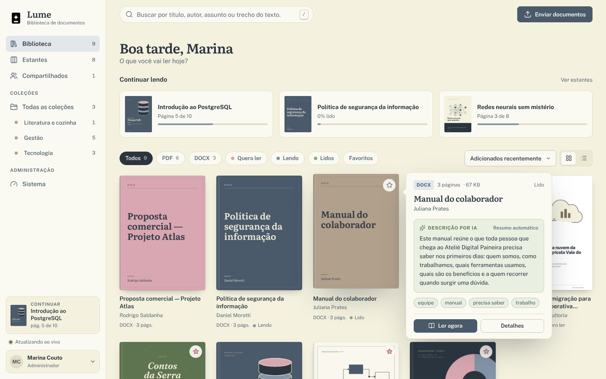
</p>

---

## Sumário

- [Visão geral](#visão-geral)
- [Novidades da versão 1.1](#novidades-da-versão-11)
- [Telas](#telas)
- [Arquitetura](#arquitetura)
- [Como rodar](#como-rodar)
- [Contas de demonstração](#contas-de-demonstração)
- [Descrição por IA](#descrição-por-ia)
- [Usando a API](#usando-a-api)
- [Configuração](#configuração)
- [Design e acessibilidade](#design-e-acessibilidade)
- [Desenvolvimento e testes](#desenvolvimento-e-testes)
- [Documentação em PDF](#documentação-em-pdf)
- [Versão para Windows](#versão-para-windows)
- [Parceria](#parceria)
- [Licença](#licença)

## Visão geral

O Lume resolve um problema comum: documentos espalhados em pastas, e-mails e aplicativos diferentes, sem capa, sem resumo e sem lembrar onde a leitura parou. Ele junta tudo numa biblioteca única, pesquisável e compartilhável, com um leitor feito para ler de verdade.

| | O que o Lume faz |
|---|---|
| **Envio** | Solte PDFs e DOCX em qualquer lugar da janela. A bandeja de envios mostra cada etapa ao vivo: na fila, lendo o documento, escrevendo a descrição, pronto. |
| **Capas** | A página 1 de cada PDF vira capa (se estiver em branco, ele tenta a próxima). DOCX ganha uma capa tipográfica na paleta do projeto. |
| **Descrição por IA** | Cada documento recebe um resumo de duas ou três frases e etiquetas sugeridas. Funciona sem chave (resumo extrativo local) ou com Claude, OpenAI, Ollama e qualquer API compatível. |
| **Leitor** | PDF com pdf.js (zoom, miniaturas, sumário, busca, temas papel, sépia e noite, modo foco) e DOCX convertido em HTML de leitura. Destaques em quatro cores, notas e marcadores por página. O progresso fica salvo. |
| **Organização** | Estantes (quero ler, lendo, lidos) com arrastar e soltar, coleções com ordem própria, favoritos, etiquetas e documentos compartilhados com todos da instalação. |
| **Busca** | Título, autor, descrição, etiquetas e o texto inteiro dos arquivos, sem diferenciar acentos, com o trecho encontrado em destaque e tolerância a erros de digitação no título. |
| **Tempo real** | Capas, descrições, contadores e estantes se atualizam pelo WebSocket, em todas as abas abertas. |
| **Operação** | Painel de sistema com filas, workers, processador e provedor de IA; retentativas com espera; recuperação de mensagens perdidas; tokens pessoais para a API; tema claro e escuro. |

## Novidades da versão 1.1

A 1.1 é uma revisão de design e de experiência de uso. Nenhuma tabela, rota da API ou variável de ambiente mudou: basta atualizar e reconstruir as imagens.

- **Identidade mais autoral.** A paleta continua a mesma (Creme, Camurça, Sálvia, Ardósia e Rosé), mas cada cor ganhou um papel: o Creme virou a "mesa" da barra lateral, o papel de leitura ficou mais claro, o texto e a ação principal usam tinta escura e o **Rosé tinta** (`#9C4A5B`) passou a ser a cor de assinatura — navegação ativa, progresso de leitura, foco e favoritos.
- **Três vozes tipográficas.** Literata para títulos e leitura, Public Sans para a interface e **IBM Plex Mono** (nova, auto-hospedada) para metadados, contadores e rótulos, como numa ficha de catálogo.
- **Cabeçalho que informa.** A saudação genérica deu lugar a data, saudação e um resumo com números reais (documentos, em leitura, em processamento) e um quadro com as três estantes.
- **Filtros como índice.** Os filtros viraram abas com sublinhado e contadores; em telas estreitas ficam numa linha só, com rolagem lateral.
- **Capas com lombada**, cantos menos arredondados, sombras mais discretas e títulos de cartão em serifa.
- **Acessibilidade.** Link "Pular para o conteúdo", anel de foco visível em todos os controles, contraste AA nos dois temas e respeito a `prefers-reduced-motion`.
- **Documentação.** Manual técnico e documento do banco de dados reescritos e diagramados de novo, agora com a fonte em HTML no repositório (`docs/fonte/`) para serem regenerados a cada versão.

## Telas

| | |
|---|---|
| 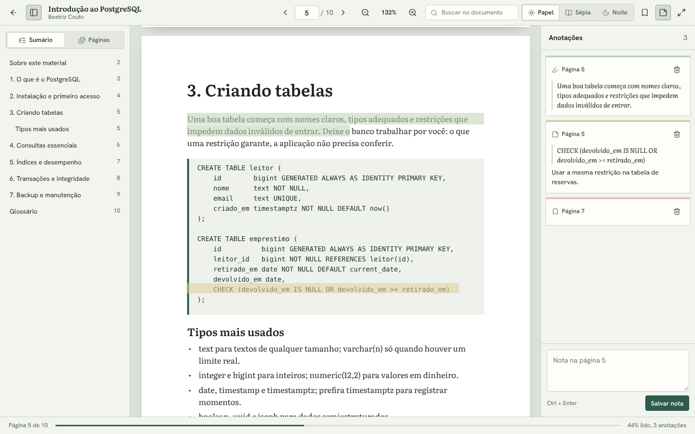 | 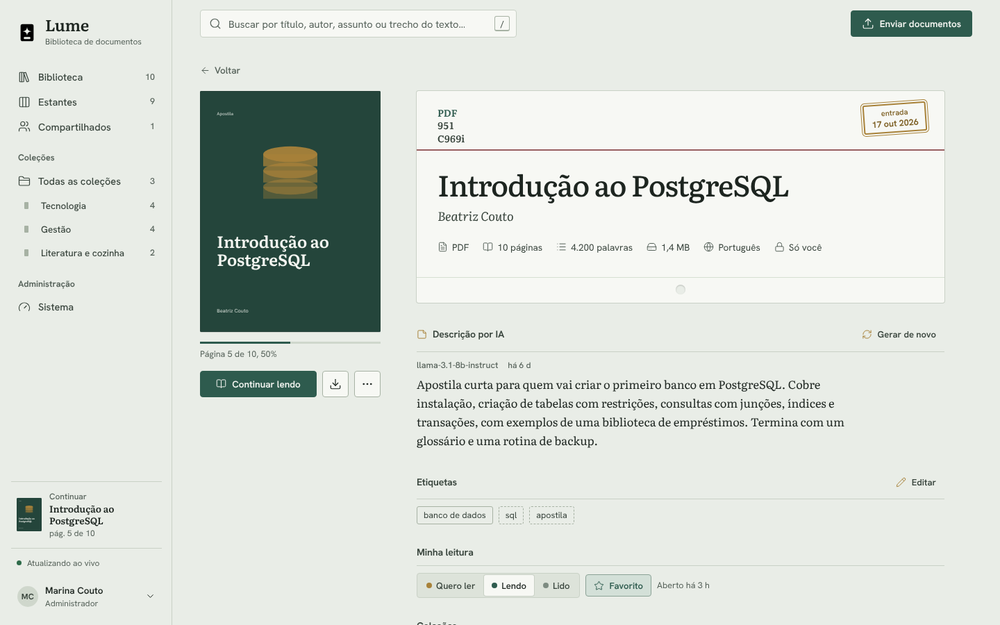 |
| **Leitor de PDF** — sumário, miniaturas, busca, zoom, destaques e notas. | **Detalhe do documento** — descrição por IA, etiquetas, estante, coleções e sumário. |
| 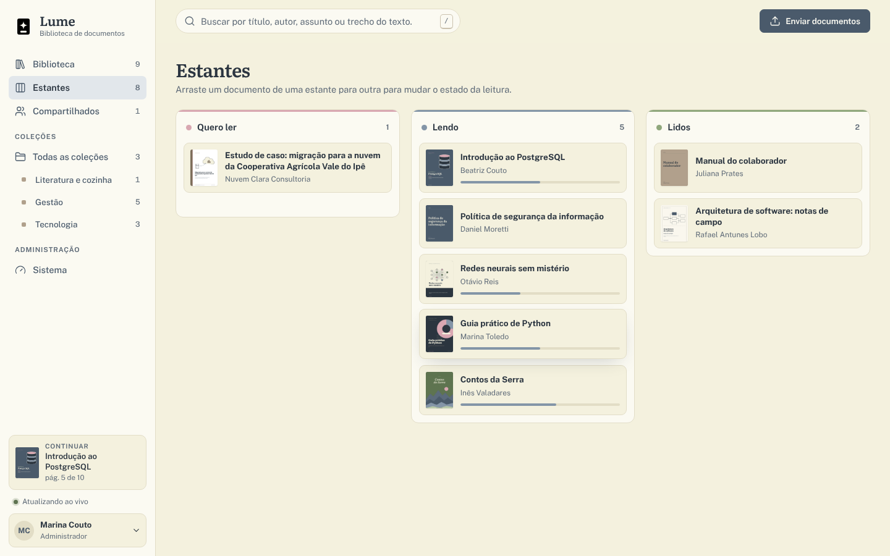 | 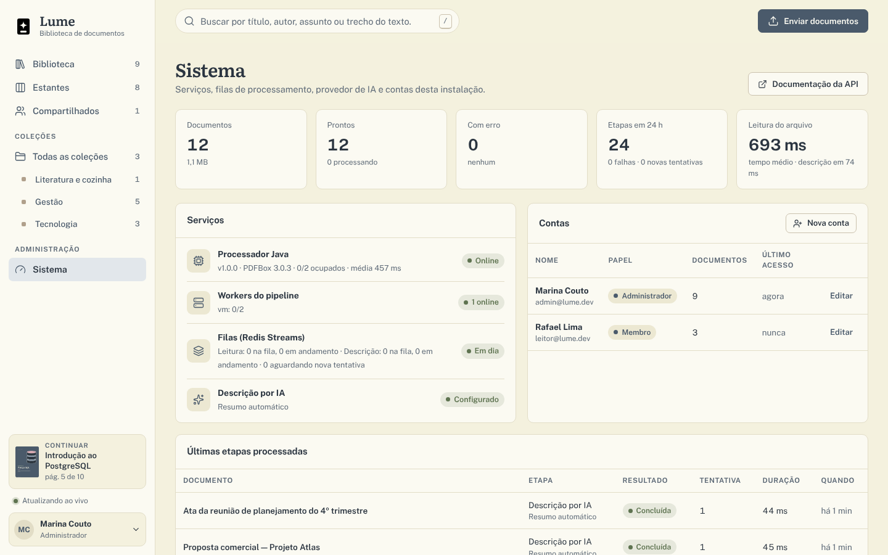 |
| **Estantes** — arraste um cartão para mudar o estado de leitura. | **Sistema** — saúde do processador, workers, filas, IA e contas. |
| 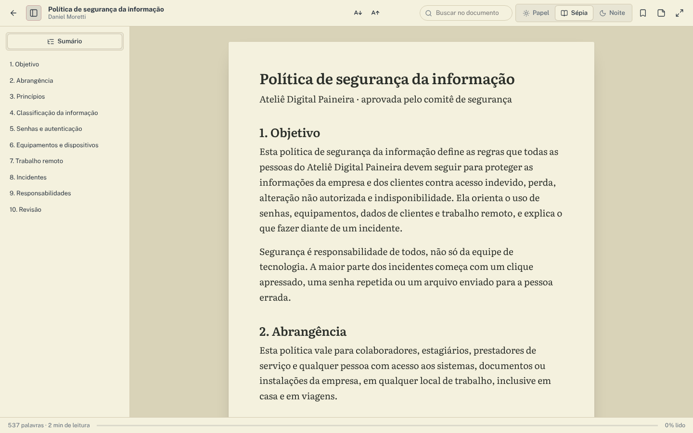 | 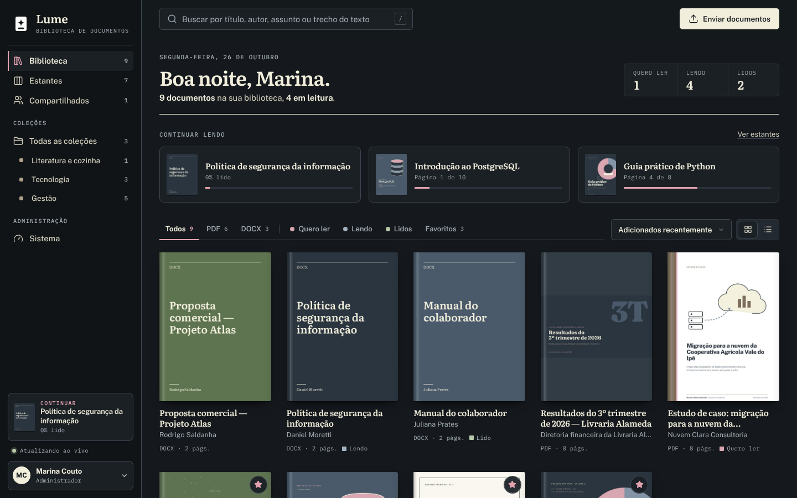 |
| **Leitor de DOCX** no tema sépia, com o sumário pelos títulos do arquivo. | **Tema escuro** — mesma hierarquia, assinatura em rosé claro. |
| 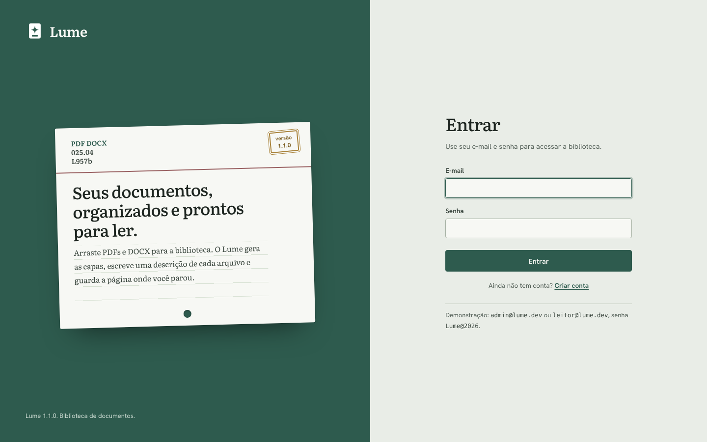 | 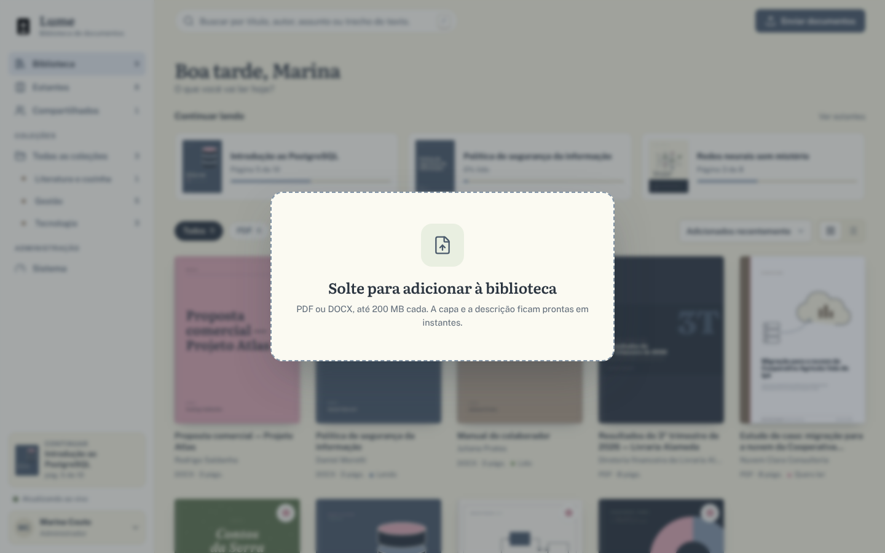 |
| **Entrada** — login e criação de conta. | **Envio** — solte os arquivos em qualquer lugar da janela. |

## Arquitetura

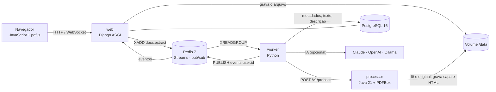

| Serviço | Linguagem | Responsabilidade |
|---|---|---|
| `web` | Python (Django 5.2, DRF, Channels, Uvicorn) | Páginas, API REST, WebSocket, sessões, permissões, envio e entrega dos arquivos com suporte a Range |
| `worker` | Python | Consome as filas, chama o processador, grava metadados e texto, escreve a descrição por IA, refaz a busca |
| `processor` | Java 21 (PDFBox 3, StAX) | Lê PDF e DOCX: páginas, palavras, sumário, metadados, texto, capa e o HTML de leitura do DOCX. Não acessa banco nem Redis |
| `postgres` | — | Fonte da verdade: documentos, leitura, anotações, coleções, contas e histórico do processamento |
| `redis` | — | Filas (Streams com grupo de consumidores), retentativas, eventos em tempo real, cache e sessões |
| Navegador | JavaScript (módulos ES, sem build) | Biblioteca, prévia, leitor, estantes, coleções, sistema e conta |

### Como um documento é processado

1. O `web` confere o conteúdo do arquivo (não só a extensão), calcula o SHA-256 para não guardar o mesmo arquivo duas vezes e grava em `/data/documents/<id>/`.
2. O documento entra em `docs:extract`. Um `worker` assume a tarefa no banco (`SELECT ... FOR UPDATE SKIP LOCKED`), então mensagens repetidas não processam nada duas vezes.
3. O processador Java devolve páginas, palavras, sumário, metadados e texto, e grava `cover.jpg` (e `reader.html` para DOCX, que o worker ainda higieniza).
4. A etapa `docs:describe` gera a descrição e as etiquetas e atualiza o índice de busca. O navegador recebe cada mudança pelo WebSocket.
5. Falhas passageiras voltam para a fila com espera exponencial (5 s, 15 s, 45 s...). Arquivos que não podem ser lidos (com senha, corrompidos, `.doc` antigo) param em "Falhou" com o motivo. Se um worker cair ou o Redis for apagado, a varredura recoloca o documento na fila.

O modelo de dados completo — diagrama de relacionamentos, cada tabela com campos, índices e restrições, máquinas de estado, busca em texto completo e uso do Redis — está em [`Banco-de-Dados-Lume.pdf`](Banco-de-Dados-Lume.pdf).

## Como rodar

Você só precisa do **Docker** com Docker Compose.

**Windows:** dê dois cliques em `iniciar.cmd`.

**Linux ou macOS:**

```bash
./iniciar.sh
```

Na primeira vez o script cria o arquivo `.env` com uma senha aleatória para o banco e uma chave secreta aleatória, sobe os contêineres (PostgreSQL, Redis, processador Java, web e worker) e abre **http://localhost:8080**.

| Endereço | O que é |
|---|---|
| http://localhost:8080 | Biblioteca |
| http://localhost:8080/api/docs | Documentação da API (Swagger) |
| http://localhost:8080/api/health | Saúde do banco e do Redis |

Para rodar sem o script:

```bash
cp .env.example .env            # troque DB_PASSWORD e APP_SECRET_KEY
docker compose up -d --build
docker compose up -d --scale worker=3   # mais workers quando precisar
docker compose logs -f worker           # acompanhar o processamento
```

> Atualizando da 1.0? Rode `docker compose up -d --build`. O esquema do banco não mudou; só a imagem `web` ganhou a nova interface.

## Contas de demonstração

Todas usam a senha **`Lume@2026`**. Elas existem só para testes, para qualquer pessoa entrar logo depois de baixar o projeto. Os nomes, os documentos de [`exemplos/`](exemplos) e o domínio `lume.dev` são fictícios.

| Papel | E-mail | O que pode fazer |
|---|---|---|
| Administrador | `admin@lume.dev` | Tudo, incluindo a tela Sistema e as contas |
| Membro | `leitor@lume.dev` | A própria biblioteca e os documentos compartilhados |

Para usar de verdade, suba com `APP_SEED_DEMO=false` num banco vazio e crie seu administrador:

```bash
docker compose exec web python manage.py createuser --admin --email voce@empresa.com --name "Seu Nome"
```

## Descrição por IA

| `AI_PROVIDER` | Precisa de | Observação |
|---|---|---|
| `local` (padrão) | nada | Resumo extrativo feito no próprio worker: escolhe as frases mais representativas e sugere etiquetas |
| `anthropic` | `AI_API_KEY` | Claude pela API de Mensagens. `AI_MODEL` padrão: `claude-haiku-5-5` |
| `openai` | `AI_MODEL` (e `AI_API_KEY`, se o serviço pedir) | Qualquer API compatível com `/v1/chat/completions`: OpenAI, Ollama, LM Studio, OpenRouter... Use `AI_BASE_URL` |

Com o perfil opcional `ia-local`, o compose sobe um Ollama na mesma rede:

```bash
docker compose --profile ia-local up -d
docker compose exec ollama ollama pull llama3.2
# no .env: AI_PROVIDER=openai, AI_BASE_URL=http://ollama:11434/v1, AI_MODEL=llama3.2
docker compose up -d web worker
```

Só o título, o autor, o sumário e um trecho do texto (até `AI_MAX_INPUT_CHARS`, padrão 12 mil caracteres) são enviados. Se o provedor falhar, o Lume usa o resumo local e registra o motivo. O botão **Gerar de novo** refaz a descrição depois de trocar o provedor.

## Usando a API

Crie um token em **Minha conta → Tokens da API** e envie no cabeçalho `Authorization: Bearer <token>`.

```bash
# enviar arquivos para uma coleção
curl -H "Authorization: Bearer $TOKEN" \
     -F "files=@relatorio.pdf" -F "files=@ata.docx" -F "collection=<id-da-colecao>" \
     http://localhost:8080/api/v1/documents

# buscar no texto completo
curl -H "Authorization: Bearer $TOKEN" "http://localhost:8080/api/v1/documents?q=backup%20postgres&sort=relevance"

# baixar o original
curl -H "Authorization: Bearer $TOKEN" -o original.pdf "http://localhost:8080/api/v1/documents/<id>/file?download=1"
```

| Rota | O que faz |
|---|---|
| `GET /api/v1/documents` | Lista e busca (`q`, `scope`, `kind`, `status`, `shelf`, `favorite`, `collection`, `tag`, `sort`, `page`) |
| `POST /api/v1/documents` | Envia um ou mais arquivos (`files`), opcionalmente numa coleção e já compartilhados |
| `GET/PATCH/DELETE /api/v1/documents/{id}` | Detalhe, edição (título, autor, descrição, visibilidade) e exclusão |
| `GET /api/v1/documents/{id}/file` · `/cover` · `/reader` | Original (com Range), capa e HTML de leitura do DOCX |
| `PATCH /api/v1/documents/{id}/reading` · `POST .../open` | Página, progresso, estante e favorito |
| `GET/POST /api/v1/documents/{id}/annotations` | Destaques, notas e marcadores |
| `POST /api/v1/documents/{id}/reprocess` · `/describe` | Ler o arquivo de novo ou só refazer a descrição |
| `/api/v1/collections` | Coleções, inclusão, remoção e ordem |
| `GET /api/v1/system` | Estado de filas, workers, processador e IA (administradores) |
| `ws://.../ws/events` | Eventos em tempo real da sessão |

A referência completa, com esquemas de entrada e saída, fica em `/api/docs` (Swagger) e no capítulo de API do manual.

## Configuração

As principais variáveis do `.env` (a lista completa está no manual):

| Variável | Padrão | O que faz |
|---|---|---|
| `APP_PORT` | `8080` | Porta no navegador |
| `APP_SECRET_KEY` | — | Chave do Django. Gerada pelos scripts; nunca publique a sua |
| `APP_ALLOWED_HOSTS` | `localhost,127.0.0.1` | Endereços pelos quais o Lume é acessado |
| `APP_HTTPS` / `APP_CSRF_TRUSTED_ORIGINS` | `false` / vazio | Use atrás de um proxy com HTTPS |
| `APP_SEED_DEMO` | `true` | Contas e documentos de demonstração num banco vazio |
| `APP_SIGNUP` | `true` | Permite criar conta na tela de entrada |
| `APP_MAX_UPLOAD_MB` | `200` | Tamanho máximo por arquivo |
| `DB_NAME` / `DB_USER` / `DB_PASSWORD` | `lume` / `lume` / — | PostgreSQL |
| `AI_PROVIDER` / `AI_API_KEY` / `AI_MODEL` / `AI_BASE_URL` | `local` | Descrição por IA |
| `WEB_WORKERS` / `WORKER_THREADS` / `PROCESSOR_CONCURRENCY` | `2` / `2` / `2` | Capacidade de cada serviço |

## Design e acessibilidade

A interface não usa framework de CSS: tudo sai de tokens em `web/static/css/app.css`, com tema claro e escuro trocados por `data-theme`.

| Papel | Claro | Escuro | Uso |
|---|---|---|---|
| Mesa | `#F4F1DE` Creme | `#111417` | Barra lateral |
| Papel | `#FAF8F2` | `#15191D` | Fundo das páginas |
| Tinta | `#1E252C` | `#F1EEDC` | Texto e ação principal |
| Assinatura | `#9C4A5B` Rosé tinta | `#E3A3B0` | Navegação ativa, progresso, foco, favoritos |
| IA | `#556B47` Sálvia escura | `#B8C9A9` | Tudo o que vem da descrição automática |
| Estantes | Rosé · Ardósia · Sálvia | idem | Quero ler · Lendo · Lidos |

**Tipografia:** Literata (títulos e leitura) · Public Sans (interface) · IBM Plex Mono (metadados, contadores e rótulos). As três são auto-hospedadas em `web/static/fonts`, sem chamadas a serviços externos.

**Acessibilidade:** link "Pular para o conteúdo", foco visível em todos os controles, rótulos ARIA nos grupos de filtros e nas ações só com ícone, contraste AA nos dois temas e animações desligadas com `prefers-reduced-motion`.

**Atalhos de teclado**

| Onde | Tecla | Ação |
|---|---|---|
| Biblioteca | <kbd>/</kbd> | Ir para a busca |
| Biblioteca | <kbd>U</kbd> | Enviar documentos |
| Leitor | <kbd>←</kbd> <kbd>→</kbd> · <kbd>PgUp</kbd> <kbd>PgDn</kbd> | Página anterior e seguinte (PDF) |
| Leitor | <kbd>Home</kbd> · <kbd>End</kbd> | Primeira e última página (PDF) |
| Leitor | <kbd>+</kbd> · <kbd>-</kbd> | Zoom (PDF) ou tamanho da letra (DOCX) |
| Leitor | <kbd>Ctrl</kbd> + <kbd>F</kbd> | Buscar no documento |
| Leitor | <kbd>F</kbd> | Modo foco |
| Leitor | <kbd>Esc</kbd> | Sair do modo foco ou voltar |

<p align="center">
  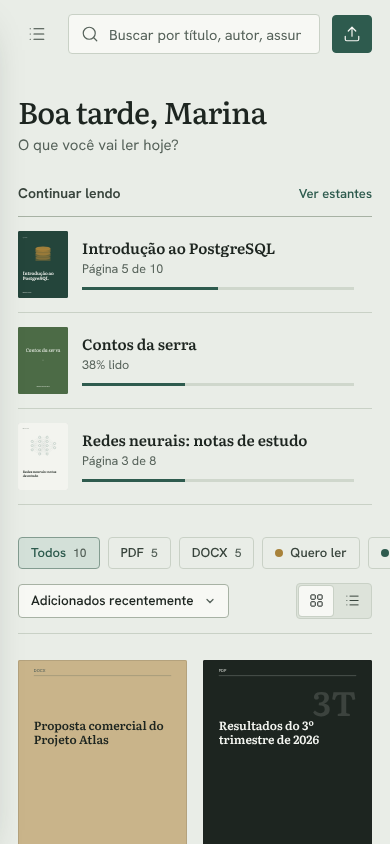
</p>

## Desenvolvimento e testes

Sem Docker, com PostgreSQL 16 e Redis 7 locais:

```bash
# processador Java
cd processor && mvn -B package
PROCESSOR_DATA_ROOT=../.data java -jar target/processor.jar

# aplicação web e worker (em outro terminal)
cd web
python -m venv .venv && . .venv/bin/activate
pip install -r requirements-dev.txt
export DB_NAME=lume DB_USER=lume DB_PASSWORD=lume APP_DEBUG=true
python manage.py migrate && python manage.py seed_demo
python manage.py worker &
uvicorn config.asgi:application --reload
```

Os testes usam PostgreSQL e Redis de verdade (o Redis de teste fica no banco 15, separado do da aplicação):

```bash
cd web
python -m pytest                       # API, uploads, permissões, busca, pipeline, IA, WebSocket
PROCESSOR_URL=http://localhost:8090 E2E_DATA_ROOT=../.data python -m pytest -m e2e   # ponta a ponta com o Java
```

São 70 testes, incluindo o caminho completo com o processador Java (PDF com marcadores, DOCX com títulos, arquivo corrompido). O GitHub Actions compila o processador, roda todos os testes e constrói as imagens a cada push.

### Estrutura

```text
web/                 aplicação Django (apps accounts, library, processing, ai, realtime, core)
  static/css/        tokens de design, componentes e leitor
  static/js/         interface em módulos ES: biblioteca, prévia, leitor, estantes, coleções, sistema
  static/fonts/      Literata, Public Sans e IBM Plex Mono (OFL)
  static/vendor/     pdf.js 5 (Apache-2.0) e licenças dos ícones
  tests/             Pytest
processor/           serviço Java 21: PDF (PDFBox), DOCX (StAX), capas e HTML de leitura
exemplos/            12 documentos fictícios usados na demonstração
docs/                manuais em PDF, imagens do README e fonte dos manuais (docs/fonte)
.github/workflows/   CI e atividade diária
```

### Como contribuir

1. Abra uma issue descrevendo a ideia ou o problema.
2. Crie uma branch a partir da `main` e envie um pull request.
3. Mudou algo visível? Atualize as capturas em `docs/images` e regenere os PDFs.
4. Quando a mudança for feita em dupla, inclua a linha `Co-authored-by:` no commit para que as duas pessoas recebam o crédito.

## Documentação em PDF

| Documento | Conteúdo |
|---|---|
| [`Manual-Lume.pdf`](Manual-Lume.pdf) | Instalação, cada tela, o leitor, a descrição por IA, arquitetura, API, configuração, testes, acessibilidade, atalhos e solução de problemas |
| [`Banco-de-Dados-Lume.pdf`](Banco-de-Dados-Lume.pdf) | Diagrama de relacionamentos, todas as tabelas com campos, tipos, chaves e índices, máquinas de estado, busca em texto completo, Redis, consultas úteis e manutenção |
| [`Apresentacao-Lume.pdf`](Apresentacao-Lume.pdf) | O projeto em dez páginas: problema, produto, arquitetura, decisões técnicas, design, qualidade e créditos |
| [`Guia-de-Uso-Lume.pdf`](Guia-de-Uso-Lume.pdf) | Para quem só usa: entrar, enviar, buscar, ler, anotar, organizar, dúvidas comuns e atalhos |

Cópias idênticas ficam em [`docs/`](docs). Todos são gerados a partir de HTML e CSS em [`docs/fonte`](docs/fonte), na mesma identidade da interface:

```bash
pip install weasyprint==70.0
python docs/fonte/gerar_pdfs.py          # todos; ou "manual" / "banco" / "apresentacao" / "guia"
```

## Versão para Windows

Quer usar o Lume sem Docker, servidor ou conta? O **[Lume para Windows](https://github.com/havelroot/Document-Library-Desktop)** traz a mesma biblioteca num único `Lume.exe`. Você arrasta arquivos ou pastas, ele gera as capas, extrai texto e sumário, escreve a descrição por IA e abre tudo no leitor próprio, com anotações, estantes, coleções e busca em texto completo. Tudo roda no seu computador.

| | Web (este repositório) | Desktop |
|---|---|---|
| Execução | Docker Compose, acesso pelo navegador | `Lume.exe` sem instalador (Windows 10 e 11, 64 bits) |
| Aplicação | Django ASGI | Processo principal do Electron |
| Banco e filas | PostgreSQL 16 + Redis 7 | SQLite com FTS5 + fila em memória |
| Leitura dos arquivos | Processador Java 21 + PDFBox | pdf.js e leitor de DOCX em JavaScript |
| Tempo real | WebSocket | IPC, sem porta de rede aberta |
| Contas | Várias, com papéis e compartilhamento | Sem conta, uso local |
| Chaves de IA | Arquivo `.env` | Cofre de credenciais do Windows |

Repositório: [havelroot/Document-Library-Desktop](https://github.com/havelroot/Document-Library-Desktop)

## Parceria

Projeto desenvolvido em parceria com meu parceiro de projetos e de vida Erik Pimenta (@ravelroot).

O repositório oficial fica em [Violet-pixel/Document-Library-Platform](https://github.com/Violet-pixel/Document-Library-Platform). A versão desktop, [Document-Library-Desktop](https://github.com/ravelroot/Document-Library-Desktop), segue a mesma parceria e reaproveita a base da versão web.

### Componentes de terceiros

O Lume inclui ou depende de componentes com licenças próprias, que continuam valendo para cada um deles:

| Componente | Uso no projeto | Licença |
|---|---|---|
| [pdf.js](https://github.com/mozilla/pdf.js) | Renderização de PDF no leitor | Apache-2.0 |
| [Apache PDFBox](https://pdfbox.apache.org/) | Serviço Java de capas, texto e sumário | Apache-2.0 |
| [Django](https://www.djangoproject.com/) | Back-end web | BSD-3-Clause |
| [Lucide](https://lucide.dev/) | Ícones da interface | ISC |
| [Public Sans](https://public-sans.digital.gov/) | Fonte da interface | SIL Open Font License 1.1 |
| [Literata](https://github.com/googlefonts/literata) | Fonte de leitura | SIL Open Font License 1.1 |
| [IBM Plex Mono](https://github.com/IBM/plex) | Fonte de metadados e rótulos | SIL Open Font License 1.1 |
| [Pytest](https://pytest.org/) | Testes automatizados | MIT |
| [WeasyPrint](https://weasyprint.org/) | Geração dos manuais em PDF (só no desenvolvimento) | BSD-3-Clause |

PostgreSQL e Redis rodam como serviços externos via Docker e não são redistribuídos neste repositório; cada um segue a licença da sua própria imagem.

Os documentos enviados pelos usuários (PDF e DOCX) pertencem aos seus respectivos autores e não são cobertos por esta licença.

## Licença

Copyright (©) 2026 Clara A. Portes

Este projeto é distribuído sob a licença [MIT](LICENSE). Você pode usar, copiar, modificar e redistribuir o código, inclusive para fins comerciais, desde que mantenha o aviso de copyright e o texto da licença.
